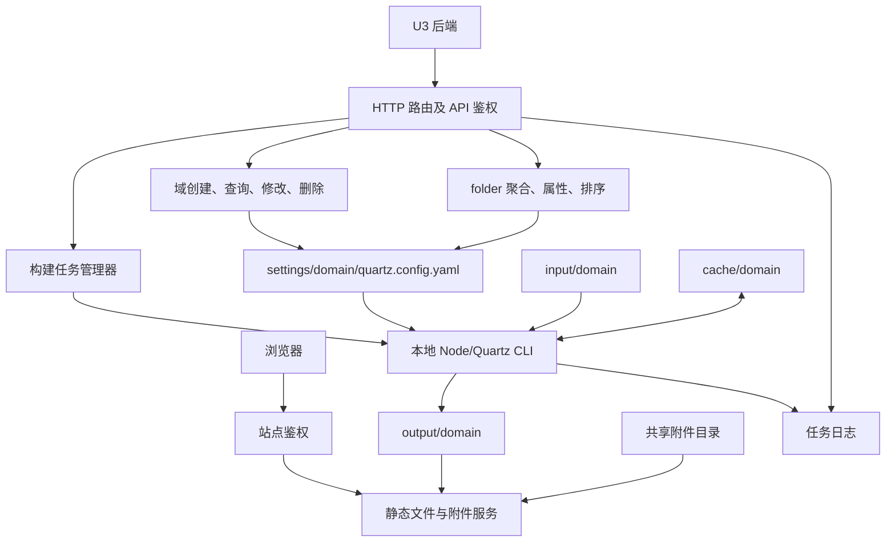

# Go Server 功能逻辑与设计审查

审查日期：2026-10-26。范围：server 下全部 10 个生产 Go 文件、已有测试，以及 Quartz5 输出目录清理的调用位置。

本次只审查、写报告和做隔离验证，没有修改 server 的生产代码。隔离验证使用生产源码副本，已核对 10 个文件内容一致；所有文件读写、清理验证只在测试临时目录进行，没有运行真实构建或删除真实业务域。

## 1. 结论

这个服务适合继续作为小型单体：管理域配置、调度本地 Quartz 构建、提供文件访问。当前方向里，业务参数集中到 configuration、调用 Quartz CLI、每域独立缓存、使用 YAML 节点保留插件和注释，都值得保留。

主要问题有两类：

1. 有影响日常使用、需要先修的功能缺陷：配置覆盖丢失、提交成功后仍可能返回失败、错误响应不是合法 JSON，以及任务成功失败无法区分。GET 清理的删除条件也需要纠正。固定站点 Cookie 经用户确认是当前有意采用的简化鉴权设计，保留现状；Windows 静态路径越界已记录，用户要求暂缓处理，均不列入本轮修复。
2. 实现职责叠加：HTTP、文件事务、业务校验、默认值、生效值说明、构建状态混在一起。最近增加的 domain_business_config.go 只统一了部分新字段，没替换旧流程，还引入重复 JSON 转换。它没有实现预期的整体简化。

建议按“修复行为错误 → 收敛配置读写 → 完善任务状态 → 精简文件服务”推进；先保持现有 JSON 字段和 folder 语义，不做一次性大重写。

## 2. 当前完整功能结构



### 2.1 模块分工现状

| 文件 | 实际职责 | 观察 |
| --- | --- | --- |
| main.go | 日志初始化、任务队列、共享任务对象、路由注册、启动监听 | 初始化与调度逻辑混合，使用包级全局对象 |
| config.go | 读取 config.json、填缺省值、解释根目录和命令参数 | 默认值有处理，启动完整性和根目录关系检查不足 |
| domain_config.go | 域路径、CRUD、配置 HTTP、folder 继承、构建提交、状态、日志、输出清理 | 约 1400 行，实际上承担了多数应用职责 |
| domain_business_config.go | 字段表、HTTP 错误输出、JSON 校验、YAML 读写、默认值、视图覆盖查询、补丁应用 | 多种职责叠加；新旧字段仍使用不同实现路径 |
| v5config.go | YAML 节点解析、配置读写、元信息、模板建域 | 节点保留方式合理；写文件缺少事务与并发保护 |
| api.go | API 凭据检查、构建查询参数校验、命令组装、进程执行 | 命令生成在提交与执行端重复；运行缺少超时和终态记录 |
| static.go | 浏览器登录、Cookie、路径解析、文件 MIME、缓存、手动流式传输 | 重复了标准库功能，且没有复用安全的域路径逻辑 |
| attachments.go | 共享附件独立目录、GET/HEAD、Range、缓存 | OpenRoot + ServeContent 的实现更清晰，可作为文件服务的参照 |
| compression.go | GZIP 包装 | 未执行配置中的 MIME 和最小大小策略 |
| config_request_log.go | 请求日志、白名单过滤后的补丁日志 | 避免记录 URL 凭据是好的；为了日志又独立解析请求体 |

### 2.2 配置有三个不同层面

| 层面 | 所有者 | 应承担的内容 |
| --- | --- | --- |
| 服务运行参数 | Go config.json | 地址、认证、四个根目录、构建并发、命令、超时、日志 |
| 域配置声明 | YAML configuration | 域标题、业务参数、按 folder 的聚合/属性/排序规则；Go 通过 JSON 更新 |
| 构建及浏览器实际参数 | Quartz5 | 插件注入、默认值、四图谱视图合并、slug 归一化和产物 |

U3 字段编码只是交接文档给对方的建表参考，不属于我方代码模型。JSON 合同与 YAML 字段仍由 Go 明确映射，不应把 U3 命名规则扩散到它们。

### 2.3 现有请求流程

| 功能 | 当前流程 | 关键说明 |
| --- | --- | --- |
| 创建域 | 认证 → 检查目录不存在 → 读模板 → 应用补丁 → 写 YAML → 创建输入目录与首页 → 再读元信息 | 中途失败可能留下部分目录；检查不存在与落盘没有统一锁 |
| 修改域 | 多次解析请求 → 读取完整 YAML → 改内存节点 → WriteFile → 再读 YAML 生成响应 | 无并发事务，保存与响应校验顺序不稳 |
| folder 修改 | 认证、目录路径归一化 → 读取同一 YAML → 修改聚合/属性/排序覆盖 → 保存 → 读取当前/继承视图 | 与域修改竞争同一个文件；继承视图是原始键口径 |
| 删除域 | 检查任务状态 → 删除配置目录 → 按请求删除输入/输出 → 删除缓存 | 检查与删除分离；部分删除失败只记日志 |
| 提交构建 | 校验参数、检查 settings/input → 按域去重 → 立即执行或 FIFO 排队 → 返回接受结果 | 串行全局一项，parallel 按域并发、没有全局上限 |
| 执行构建 | 创建任务日志 → 拼命令数组 → 加 --settings/-d/-o/--cacheDir → cmd.Run → 记录日志 → 删除活动任务并启动下一项 | 成功失败不保留在状态模型中 |
| 查询日志 | 活动任务直接读日志；否则扫描该域文件名前缀并按修改时间找最新 | 实际为整文件 ReadFile，不是日志流；历史仅标记 completed |
| 站点访问 | URL 凭据换 Cookie → 按域和路径定位文件 → HTML/JSON 自写响应，其他小文件 ServeFile | Cookie 和路径边界均有明确问题 |
| 共享附件 | 同一站点鉴权 → OpenRoot → 校验普通文件 → ServeContent | 不参与 Quartz 构建，支持 Range 与修改时间验证 |
| 输出清理 | 检查任务快照 → 列 settings 下目录作为合法域 → 扫 output → confirm 时删除其他条目 | GET 也会因 confirm=true 删除，且不能阻止检查后的新任务 |

## 3. 已确认问题与处理状态

当前优先处理影响日常使用的问题。P1 表示建议优先修复，P2 表示需要纳入收敛和可靠性改进；标为设计取舍或暂缓的项目只保留记录，不纳入当前实施范围。

### 3.1 已确认的设计取舍：站点和附件使用固定 Cookie

位置：[static.go:143](D:/CodeProjects/quartz-fullstack/server/static.go:143)、[static.go:154](D:/CodeProjects/quartz-fullstack/server/static.go:154)。

Cookie 固定为 quartz_auth=valid，校验只比较这一个字符串。客户端自己构造该 Cookie 就能进入受保护站点；没有服务端会话或签名，也没有有效期的服务端验证。

隔离验证已直接访问测试页成功。这个结论针对站点和共享附件，不能据此说 API 凭据验证也被绕过。

用户已确认：这是为了简化鉴权而有意采用的设计，目前保留，后续有需要再调整。因此本项是已知行为与设计取舍，不列为本轮待修缺陷。若将来调整，可选择随机会话或签名票据；当前不实施这类改造。API 凭据验证与该浏览器 Cookie 是不同机制。

### 3.2 暂缓处理：Windows 的 HTML/JSON 静态分支可越过 output 根目录

位置：[static.go:15](D:/CodeProjects/quartz-fullstack/server/static.go:15)、[static.go:162](D:/CodeProjects/quartz-fullstack/server/static.go:162)。

静态入口把 URL 第一段直接当域名拼接文件路径，没有使用 validateDomainName/Paths。Windows 将反斜杠视为目录分隔符，编码后的反斜杠可使拼接结果越过 output。

验证中特意在临时 output 外放置一个 marker.json，通过完整 ServeMux → staticHandler 路径取得了它。测试普通 txt 时标准 ServeFile 返回 400；HTML/JSON 手工 os.Open 分支绕过了这项保护。因此不是仅凭 filepath.Join 作出的推测。

处理状态：用户要求先记录，暂缓修复；当前工作重点是影响正常使用的问题。此项缺陷仍存在，不代表已经修复。

后续处理方向：域 ID 与文件相对路径分别校验，使用受限根目录访问；复用附件已有的 OpenRoot 思路。仅 Clean 路径或依赖 ServeMux 不够。

### 3.3 P1：并发配置修改会丢更新，文件落盘也不是原子提交

位置：[domain_config.go:300](D:/CodeProjects/quartz-fullstack/server/domain_config.go:300)、[v5config.go:602](D:/CodeProjects/quartz-fullstack/server/v5config.go:602)。

所有接口都是“读整份 YAML → 修改 → 写整份”。两个请求先后读取同一旧版本，即使修改不同字段，后保存的请求也会把前一个请求的字段恢复成旧值。已用两个独立 LoadV5Config 实例确定性复现。

同时，os.WriteFile 直接截断原文件再写入。构建或另一个 GET 在写入中读取，可能读到空文件或半份文件；崩溃和写入失败也没有保留旧文件的保证。这部分由代码直接确认，没有人为制造进程崩溃。

建议：一个 ConfigStore.Update(domain, mutation) 统一承担“加域锁 → 读 → 校验 → 修改 → 序列化 → 临时文件写入 → 替换提交”。单进程可先用域级锁；若部署多个进程或允许外部编辑，则需要文件锁或版本冲突检查。Windows 的替换语义应单独验证，不能把一次普通 Rename 当作全平台承诺。

### 3.4 P1：GET 清理接口实际可以删除文件

位置：[domain_config.go:1310](D:/CodeProjects/quartz-fullstack/server/domain_config.go:1310)、[domain_config.go:1333](D:/CodeProjects/quartz-fullstack/server/domain_config.go:1333)。

方法允许 GET 和 POST，但删除条件只看 confirm=true。因此带认证的 GET /api/output/cleanup?confirm=true 会删目录，已在临时目录复现。

建议：GET 永远只预览；执行删除限定 POST 并明确确认语义。方法检查必须参与删除判定。清理与构建提交还需要同一个操作协调机制，避免“检查时无任务，开始删除时新任务已经运行”的竞争。

### 3.5 P1：配置已经保存，接口却返回失败

位置：[domain_config.go:300](D:/CodeProjects/quartz-fullstack/server/domain_config.go:300)、[v5config.go:649](D:/CodeProjects/quartz-fullstack/server/v5config.go:649)。

SaveDomain 先保存，再通过 LoadDomainInfo 重新读取并校验 explorer/graph。如果原 YAML 的另一项配置不合法，修改标题仍会落盘，然后响应 500。已通过一个原有 explorer 类型错误的配置复现。

建议：所有可能导致本次操作失败的校验、响应数据生成都在提交前完成；提交成功后使用同一份已验证的内存快照响应，避免保存后重新读取另一份状态。GET 的域身份信息也不应因无关可选参数错误而整个消失。

## 4. 其他已确认的问题

| 优先级 | 问题 | 影响与证据 | 建议 |
| --- | --- | --- | --- |
| P2 | 未知资源路径仍能改域 | main 后缀分发的兜底进入域配置；/api/domain/demo/misspelled 仍被解释为 demo 的 PUT，已复现 | 用精确路由模式，未知路径返回 404 |
| P2 | 白名单的“忽略”不真实 | decodeWhitelistedBody 记录 PAGE_TITLE 未知，但未从 raw 移除；encoding/json 不区分结构体字段大小写，最终仍修改标题，已复现 | 让允许字段判定、解码、日志、实际应用使用同一份解析结果 |
| P2 | 同类校验返回不同状态 | folder_depth=0 返回 500，min_group_size=0 返回 400，已复现前者 | 统一输入错误、缺失资源、冲突、内部错误四类处理 |
| P2 | 手拼 JSON 遇路径失效 | Windows 反斜杠和错误中的引号没转义；缺失域 GET 已复现非法 JSON | 全部使用 json.Encoder，错误结构与成功结构一致 |
| P2 | JSON 静态资源返回 text/html | .json 被与 HTML 放在同一分支，直接设置 HTML MIME，已复现 | MIME 判断与缓存策略分离，用标准文件响应 |
| P2 | GZIP 配置名与行为不一致 | min_size_kb/types 没参与压缩判断，gzip;q=0 也被压缩，已复现 | 真正执行协商与策略，或者从服务删除这些无效配置 |
| P2 | 任务读取返回共享指针 | GetTaskState/GetTaskList 只复制容器；排队转运行会原地改对象，已验证已取出的对象随后变化 | 对外返回值快照，所有状态修改都由任务管理器在锁内完成 |
| P2 | 旧标量 setter 保留错误 YAML 类型 | folderDepth 原为字符串时，SetFolderDepth(2) 只改 Value 不改 Tag，最终仍写字符串，已复现 | 普通标量更新统一类型规则：明确拒绝错类型或正确替换节点 |
| P2 | 生成首页未转义标题 | displayName 直接拼入 index.md 的 YAML frontmatter；“项目: 管理”这样的标题可生成非法 frontmatter | 用 YAML 编码生成 frontmatter，Markdown 正文另行生成 |
| P2 | 坏域在列表里被静默跳过 | ListDomainsInfo 读取元信息失败后 continue；配置错误会让域从列表中消失 | 返回域 ID、配置错误状态，避免隐藏可修复对象 |
| P2 | 删除接口可能部分成功却报完整成功 | input/output/cache 删除错误只写日志；非法 JSON body 被忽略 | 明确验证请求，返回各项结果；需要一致性时采用先标记/隔离再清理 |

来源：[main.go:258](D:/CodeProjects/quartz-fullstack/server/main.go:258)、[domain_config.go:663](D:/CodeProjects/quartz-fullstack/server/domain_config.go:663)、[static.go:197](D:/CodeProjects/quartz-fullstack/server/static.go:197)、[compression.go:36](D:/CodeProjects/quartz-fullstack/server/compression.go:36)、[main.go:155](D:/CodeProjects/quartz-fullstack/server/main.go:155)、[v5config.go:285](D:/CodeProjects/quartz-fullstack/server/v5config.go:285)、[domain_config.go:257](D:/CodeProjects/quartz-fullstack/server/domain_config.go:257)。

## 5. 构建与任务管理的设计缺口

### 5.1 状态模型没有终态

当前 TaskState 只有 queued/running，EndTask 直接删除对象。成功与失败对 status 接口都变成 idle；历史日志只返回 completed，机器调用方必须自己解析文本判断结果。

建议任务至少有 queued/running/succeeded/failed/canceled；保存 taskId、提交/启动/结束时间、退出码、日志位置。先保留最近任务的有界内存记录即可，是否跨重启持久化另行按需求决定。

taskId 与日志名使用秒级时间；同一域在同秒内先后完成并再次提交会发生碰撞，日志以 O_TRUNC 打开，可能覆盖上一份。采用真正唯一的任务 ID，并让日志名与它对应。

### 5.2 构建没有超时或取消

[api.go:178](D:/CodeProjects/quartz-fullstack/server/api.go:178) 使用 exec.Command + Run。进程挂住时串行队列不会继续，也无法通过现有删除接口解除该域的忙状态。parallel 模式没有全局并发上限。

建议使用可取消的构建上下文与服务级超时，明确停止子进程树的 Windows 行为。继续使用一个简单队列；以 worker 数量表达并发上限，串行就是 1。无需引入外部消息队列。

### 5.3 构建直接作用于正在服务的目录

Go 的 -o 指向 output/domain；Quartz5 全量构建会先清理该目录，SQLite 模式的 reset/缺失基线也会清理。来源：[quartz5/quartz/build.ts:202](D:/CodeProjects/quartz-fullstack/quartz5/quartz/build.ts:202)、[build.ts:282](D:/CodeProjects/quartz-fullstack/quartz5/quartz/build.ts:282)。

这意味着构建期间会出现旧文件缺失、新文件尚未齐全，失败时不能保证旧站点仍可访问。它是否必须马上改，取决于是否允许维护窗口。

如果允许维护窗口，应明确展示构建状态；如果要求构建时站点连续可访问，需要独立的构建工作目录和成功后的发布切换。SQLite 增量缓存绑定输出路径和完整产物，发布目录设计必须一起考虑，不能仅把 -o 换成随机目录后就认为增量行为不变。Windows 非空目录也不能简单宣称可原子覆盖。

### 5.4 生命周期操作缺少共同协调

构建管理器的锁只保护自己的 map/queue，不保护域目录。删除检查、创建检查、清理检查与真正操作之间都有时间窗口；配置写入也没有与构建的配置读取建立快照关系。

建议定义最少的操作规则：同域创建/删除/配置提交互斥；构建使用确定的配置版本；清理与调度互斥。构建长任务不必一直占配置写锁，可以使用提交后的配置快照或在运行期间明确拒绝修改，两种策略选定一种即可。

## 6. 配置代码为什么变复杂，以及怎么简化

状态：以下问题已通过当前源码确认并记录，本次审查尚未重构。业务配置移到 YAML 全局 configuration 的方向保留；问题在于 Go 的实现叠加了不必要的处理，并未完成新旧逻辑收敛。U3 字段编码仍只属于交接文档，与我方代码无关；不恢复旧插件配置位置的兼容逻辑。

### 6.1 现在的重复来自哪里

域 PUT 的实际路径包括：读取 body → 日志独立 JSON 解码 → validateBusinessBody 再解码 → decodeWhitelistedBody 再解码并重新编码 → DomainPatch 解码 → 新字段各自解码。旧标题/目录层数还走另一套 setter。

GET 的 BusinessView 和 GraphViewOverrides 则是 YAML 节点 → Go 动态值 → JSON 字节 → 再解码并校验 → 最终 JSON 响应。这一轮中间 JSON 转换没有承担必要的数据交换职责。

字段表 Default 同时作为默认值与类型判定依据；MinGroupSize 又单独构造一条映射并转 JSON；旧的 page_title/folder_depth 没有进入同一机制。最后形成新旧两套逻辑，而不是用通用逻辑替代重复。

位置：[domain_config.go:617](D:/CodeProjects/quartz-fullstack/server/domain_config.go:617)、[domain_business_config.go:97](D:/CodeProjects/quartz-fullstack/server/domain_business_config.go:97)、[domain_business_config.go:176](D:/CodeProjects/quartz-fullstack/server/domain_business_config.go:176)。

### 6.2 建议保留的最小机制

1. 用明确的 DomainPatch、ExplorerPatch、GraphPatch 表达接口；标量用指针保留“省略”和 false/0 的区别，字段链保留有序数组。
2. 请求边界解码一次，保留所需的出现/空值信息，再做业务校验；日志直接使用已解析并筛选的补丁。
3. 通用化 YAML 的少数节点操作：按路径定位、设置已知类型标量、设置序列、删除覆盖。新旧普通字段都复用它，避免再增加一套动态类型框架。
4. folder 字段链与排序保留专门的业务处理，因为它们确实有继承、删除和 sort:null 语义。不要为了“通用”把这些语义塞进默认值类型推断。
5. 返回声明配置和元信息，直接编码 JSON；不要为了复用请求校验再转一次 JSON。
6. GraphViewOverrides 不是当前 U3 必需功能，可从普通域详情移除；若以后需要解释实际图谱参数，由 Quartz5 提供构建后的 resolved 信息。Go 不复制四视图合并规则。

是否保留一个很小的“字段→路径”清单不是核心争议。它可以帮助普通字段减少重复，但应明确类型、统一旧字段，并只承担映射职责。当前把映射、默认值、校验、响应、视图解释绑在一起才是问题。

### 6.3 默认值与校验的边界

Go 应校验接口类型、数值范围、域/目录路径和补丁语义；Quartz5 负责插件内部互斥与最终视图行为。两边不应再各自推断一遍插件运行参数。

更简单的选择是：模板显式列出开放给管理端的业务默认值；新域复制它；GET 返回已有声明，缺失用明确的“未配置”表达，最终渲染缺省仍交给 Quartz5。若 API 必须始终返回完整默认值，也应把它定义成明确合同，并有一处可验证的默认值来源，不能暗中依赖 JS 插件默认长期与 Go 注册表一致。

folder 继承值目前 Go 按原始目录键匹配，Quartz 会 slug 归一化。比如大小写和空格可能使两边看到不同的有效目录。应统一目录标识合同，或由构建产物提供最终解析结果，不在 Go 逐步复制 slug 和插件规则。

未知键当前约定 warnings 并忽略，可以保留，但必须真正过滤。若要改成未知字段返回 400，应作为明确的接口合同调整，不能在重构中悄悄改变。

## 7. 推荐的简单结构

可以继续保持单个 Go 模块甚至单个 package，不需要拆微服务或引入通用依赖注入框架。逻辑上收敛为以下职责即可：

| 部分 | 应负责 | 不应负责 |
| --- | --- | --- |
| HTTP / Routes | 精确路由、认证、一次解码、统一 JSON/状态码、请求体限制 | 操作 YAML 节点、直接启动进程 |
| DomainService | 域路径、创建/删除、生命周期协调 | 编排插件和图谱规则 |
| ConfigStore | 单域加锁、Load、已知补丁、完整校验、原子提交 | HTTP 响应、U3 字段编码、插件生效值合并 |
| BuildManager | 队列、并发上限、任务状态、快照、启动/结束/取消 | 读取 HTTP 参数、让调用方修改状态指针 |
| BuildRunner | 一个命令生成函数、进程上下文、任务日志、退出结果 | 自己改变队列或写业务配置 |
| FileHandler | 受限根目录、MIME、缓存、GET/HEAD/Range | 自制认证凭据、手动模拟整套 HTTP 文件传输 |

main 只负责把 Config、Managers 和 Handlers 装配起来。使用一个 App 结构体持有这些对象即可，减少依赖包级 cfg/domainManager/domainTaskManager 的测试环境切换。文件可以沿用现有名称逐步整理，不以拆出多少文件作为完成标准。

配置更新的目标流程：

```text
JSON 请求 → 一次解码 → 明确 DTO 校验
→ ConfigStore 在域锁内读取当前 YAML
→ 应用已知路径补丁 → 校验并生成响应快照
→ 安全提交文件 → 返回一次 JSON 响应
```

构建的目标状态流：

```text
提交 → queued → running → succeeded / failed / canceled
```

## 8. 适合优先删减、保留和调整的内容

| 动作 | 内容 |
| --- | --- |
| 保留 | 全局业务配置、单份域 YAML、folder 继承语义、yaml.Node、每域独立缓存、串行队列、无 shell 的命令参数数组 |
| 删除或合并 | 查询中的 JSON 中转、按默认值猜类型、重复请求体解码、重复命令组装、非必需 view_overrides |
| 替换 | GET 删除、直接 WriteFile；静态路径和文件响应改造暂缓 |
| 当前保留的设计取舍 | 固定站点 Cookie：用户明确要求暂时保留，后续有需要再改 |
| 已记录、暂缓处理 | Windows HTML/JSON 静态路径越界；当前优先处理影响使用的问题 |
| 统一 | 新旧简单字段读写、错误类别和 JSON 编码、目录标识、共享状态访问规则 |
| 按需求选择 | 构建时是否允许维护窗口、历史任务是否跨重启持久化、是否允许外部编辑 YAML |

配置启动时还应检查必填路径、路径根之间的冲突、模板与解释器是否可用、保留 URL 名称。当前 filepath.Clean("") 会变成当前目录，缺失根目录不应被当作正常默认。HTTP 服务也应有请求体上限、ReadHeaderTimeout、明确的关闭流程。

## 9. 调整顺序和验收

### 第一阶段：修复已复现的行为错误

配置事务、保存结果与响应一致、统一错误 JSON、首页标题正确转义、GET 清理方法约束。保持现有接口字段名和 folder 空数组/null 语义；固定站点 Cookie 保留，Windows 静态路径越界仅记录、暂缓处理。

验收：GET 不删除；并发修改不同字段不丢更新；错误返回合法 JSON；失败响应不会暗中提交更改；正常标题不会生成非法首页 frontmatter。

### 第二阶段：收敛配置实现

移除查询 JSON 中转和非必需视图解释；统一新旧简单字段；请求只解码一次；域 GET 与列表能呈现配置错误，而不是隐藏整个域。

验收：false、0、[] 和省略的语义不变；未知键行为一致；插件/layout 内容与 YAML 注释、锚点继续保留；U3 编码只存在交接文档；Go 不定位插件业务 options。

### 第三阶段：补齐任务生命周期

任务终态、唯一 ID、只读快照、超时/取消、删除/清理与调度协调；统一命令生成。

验收：成功与失败可通过 API 区分；一次失败不阻塞后续队列；日志不覆盖；读取状态无共享可变指针；忙域不会被并发删除。

### 第四阶段：简化文件服务与发布约定

按实际使用问题调整 MIME/缓存和压缩；根据是否允许维护窗口决定是否引入独立发布切换。受限文件访问和静态路径边界改造作为后续记录，当前暂缓，不自动纳入本轮工作。

## 10. 验证记录与限制

- 现有 server 的 go test ./... 通过。说明已有覆盖通过，不说明下面的缺陷已经修复。
- 在 `.task-builds/server-design-audit` 复制生产源码后，增加行为观察测试；所有操作使用临时目录。测试用于复现当前错误，因此测试通过表示“缺陷被观察到”，不是“实现正确”。
- 观察项：伪造 Cookie、Windows JSON 路径越界、丢失更新、GET 删除、白名单警告仍写入、错误 MIME、压缩策略无效、任务指针共享、旧 setter 类型保留、状态码/错误 JSON、保存后报错、未知资源路径更新、首页标题 frontmatter。
- Windows 越界验证经过 ServeMux；普通 txt 的标准 ServeFile 分支被拒绝，JSON 手工分支成功读出 output 外临时标记。这一区分影响修复范围。
- 未运行真实业务域构建、未重启服务、未做线上压测或进程崩溃注入；并发时序、调度和发布窗口中未做实验的部分明确按源码判断。没有声称跑过 race detector。
- 审查没有修改生产代码。后续重构应分阶段实施，以行为验收为准，避免再将功能补齐与通用框架扩张混在一次修改中。
